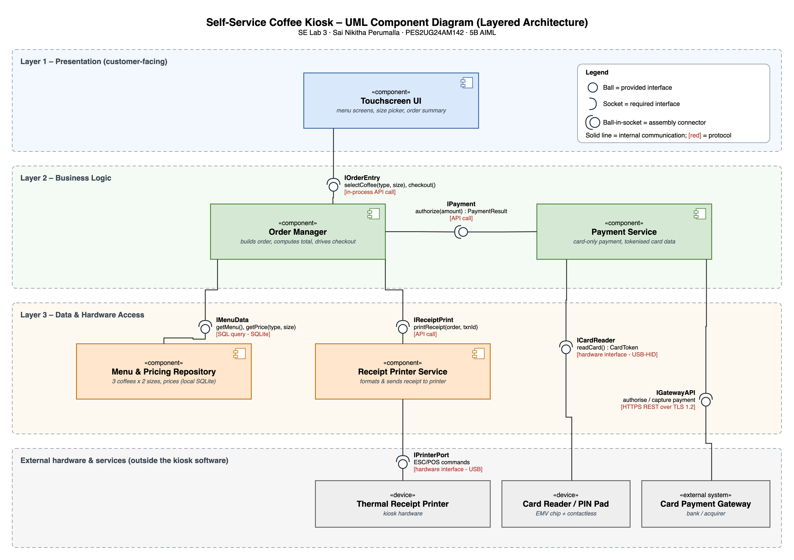

# Lab 3 – Component Modelling & Architectural Pattern Selection

**Sai Nikitha Perumalla · PES2UG24AM142 · 5B AIML** – UE24CS341A Software Engineering

Scenario: Self-Service Coffee Kiosk System · Chosen architecture: **Layered**

| Deliverable | File |
|---|---|
| Component diagram (PNG) | [CoffeeKiosk_ComponentDiagram.png](CoffeeKiosk_ComponentDiagram.png) |
| Component diagram (PDF) | [CoffeeKiosk_ComponentDiagram.pdf](CoffeeKiosk_ComponentDiagram.pdf) |
| Diagram source (draw.io) | [CoffeeKiosk_ComponentDiagram.drawio](CoffeeKiosk_ComponentDiagram.drawio) |
| Written justification (PDF) | [Justification_PES2UG24AM142.pdf](Justification_PES2UG24AM142.pdf) |

